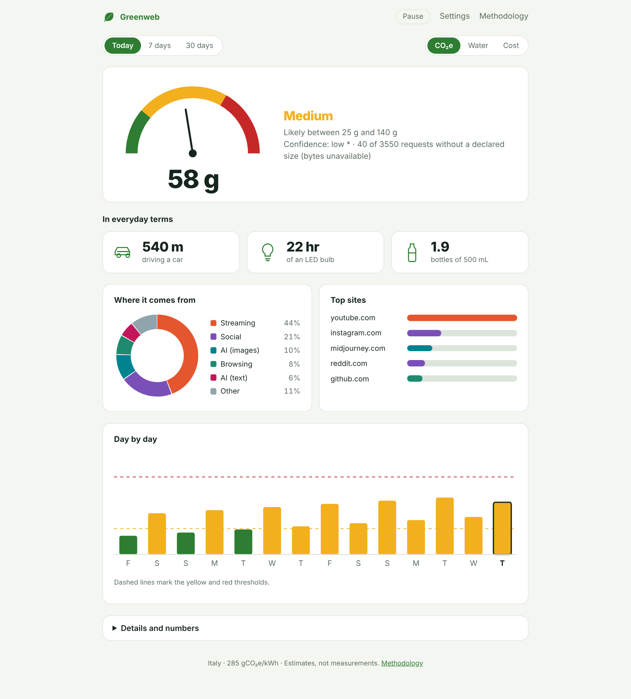

# Digital Footprint Counter

Free, open source browser extension that **estimates** the environmental footprint of your browsing: energy, CO₂e, water and an equivalent electricity cost. Everything runs locally: no account, no server, no telemetry.

> Estimates, not measurements. Browsers cannot see server consumption, so every value is a documented range with a reliability level. See the in-extension **Methodology** page (`methodology/`) for formulas, coefficients and sources.



## Features
- Toolbar **leaf** (green / yellow / red) with a badge showing today's value for your chosen metric (CO₂e, water or cost).
- **Dashboard**: current session, today, 7 and 30 days; breakdown by activity and by site; everyday equivalences.
- **Methodology** page generated from the same JSON the engine uses: every number traces back to a method and a source.
- Optional, per-service count of AI messages (ChatGPT, Claude, Gemini, Perplexity, DeepSeek) to replace the assumed usage rate with real numbers: only the number is kept, never the content. Rules are checked with real traffic from Settings (see `docs/AI_ADAPTERS.md`).
- Six regional profiles (Italy by default, EU, USA, China, Japan, world average), all overridable.
- Interface in English and Italian; more languages by adding one JSON file.

## Privacy
- Stores only **domain**, request count, bytes and active time, on your device (`storage.local`). Never full URLs, page content, prompts, cookies or passwords.
- No network access of its own (enforced by the extension's security policy), no remote code, no analytics.
- Controls in Settings: pause, sites to never track, retention (7/30/90 days), CSV export of everything stored, delete all. Private windows are never tracked.
- Permissions: `webRequest` (observe requests, read-only), `idle` (stop counting when you are away), `storage`, `alarms` (one tick per minute) and access to http/https sites (needed by `webRequest`).

## Install (development)
- **Chrome / Edge / Brave**: `chrome://extensions` → Developer mode → *Load unpacked* → select this folder.
- **Firefox (121+)**: `about:debugging` → This Firefox → *Load Temporary Add-on* → select `manifest.json`.

```bash
npm test          # unit tests (Node 20+)
npm run lint      # web-ext lint (Firefox rules)
npm run package   # dist/digital-footprint-counter-<version>.zip
python3 -I scripts/update-ember.py   # grid carbon intensity from Ember's yearly data (--apply to update)
```

## How it works (short)
`energy = active hours × device power + (GB × kWh/GB | hours × kWh/h | hours × usage × energy per operation)`, then `CO₂e = energy × grid intensity`, `water = energy × L/kWh`, `cost = energy × price`. Energy is stored; the three metrics are computed on display. Details and limits: `methodology/` and [`docs/OPEN_QUESTIONS.md`](docs/OPEN_QUESTIONS.md). Extension's own footprint: [`docs/EXTENSION_IMPACT.md`](docs/EXTENSION_IMPACT.md).

## Contributing
- **Language**: copy `locales/en.json` to `locales/<code>.json`, translate, add it to `data/languages.json`.
- **Domains**: add `"domain": "category"` to `data/catalog.json` (most specific match wins).
- **Coefficients**: edit `data/coefficients.json`. Every value needs a source, a `min/mid/max` range, a reliability and a `status` (`sourced`, `to_verify`, `assumption`). No unsourced numbers presented as facts.

## Distribution
Plan and checklist: [`docs/DISTRIBUTION.md`](docs/DISTRIBUTION.md). Store texts and images: [`store/`](store/). Privacy policy: [`PRIVACY.md`](PRIVACY.md).

## License and citation
MIT © Michele Aldeni. Keep the copyright notice in copies (see `LICENSE`); a citation is welcome, see `CITATION.cff`.
